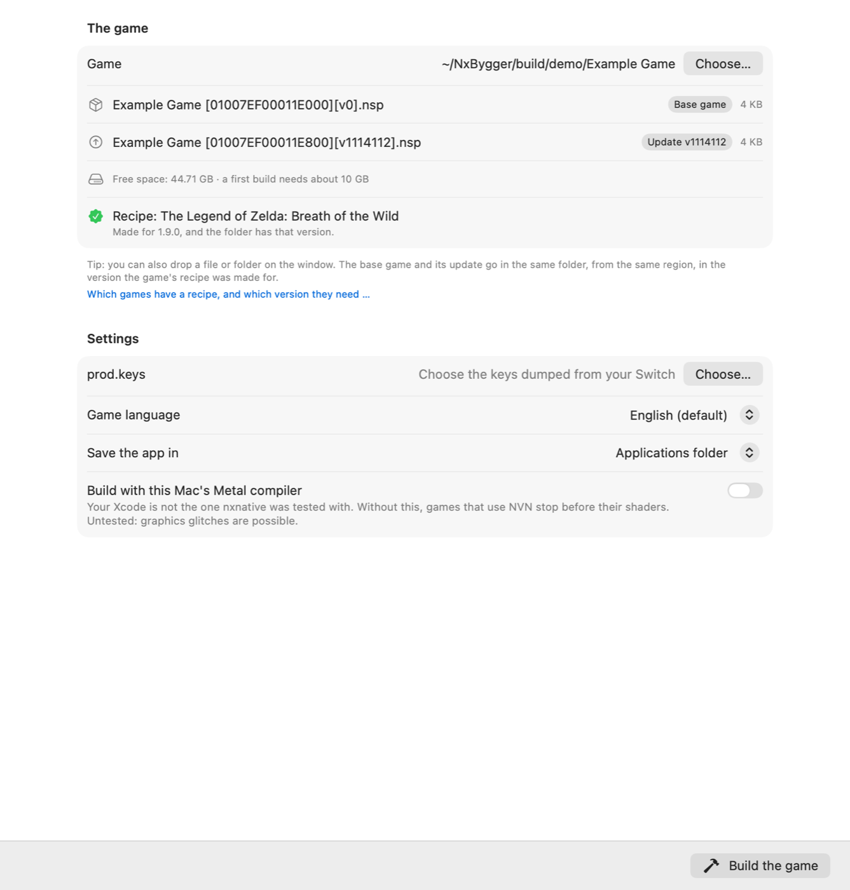
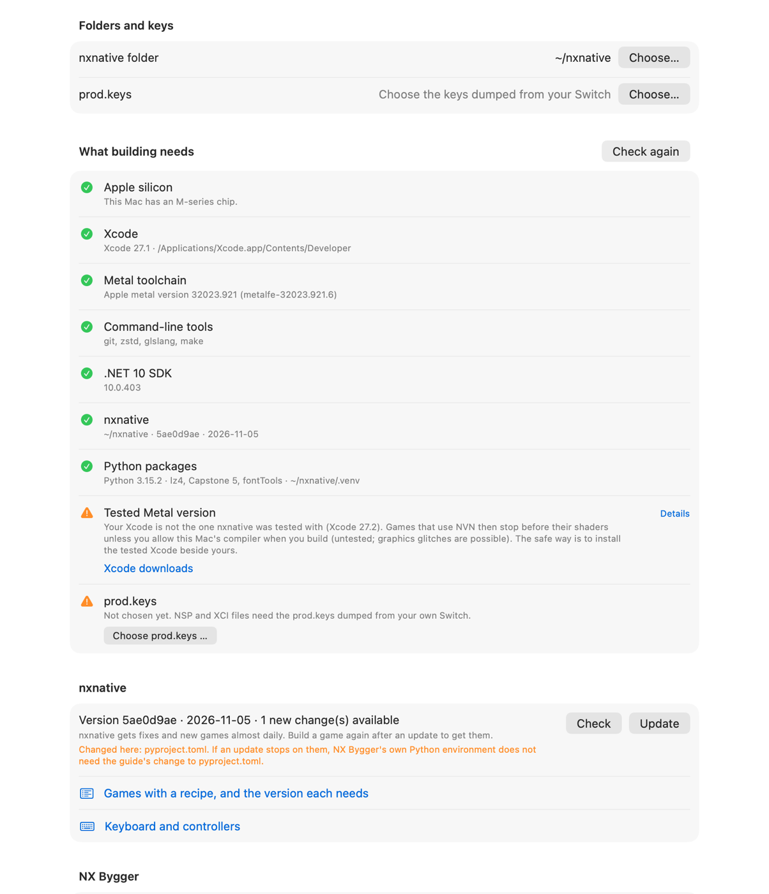
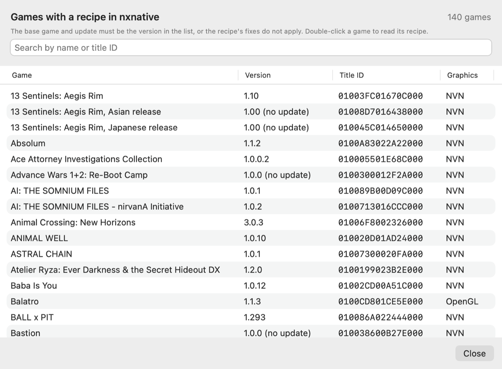

# NX Builder

**Build the Switch games you own into Mac apps with [nxnative](https://github.com/seedds/nxnative), without the Terminal.**

NX Builder is a small, free macOS app on top of nxnative. You pick a game file, press **Build**, and get a
double-clickable Mac app of the game. It sets up what nxnative needs, explains what goes wrong in plain words,
and keeps your built games in a library. It speaks eight languages and follows your Mac's.

> NX Builder contains no games, keys or copyrighted Nintendo material, and links to none. You need dumps of games
> you own and the `prod.keys` from your own Switch. NX Builder is not affiliated with Nintendo, and it is a separate
> project from nxnative: report NX Builder problems here, not to nxnative.

<p align="center">
  
  
</p>
<p align="center">
  
</p>

## What it does

- **Builds a game in one click.** It runs nxnative's own build script (`build_ipa_from_nsp.py --platform mac-app`)
  and shows each step, a progress bar, the time left and the log as it happens. The Mac stays awake while it works.
- **Sets up a new Mac for you.** On first start a welcome window lists what the Mac still needs and installs it with
  one click: Homebrew and the .NET 10 SDK from their signed and notarized installers (checked before they run), zstd,
  glslang and uv, Xcode's Metal toolchain, nxnative itself and a Python environment of its own. The Mac's password is
  asked once. Xcode comes from the App Store with your Apple ID: NX Builder opens its page, waits, and sets Xcode up
  when it is there. No Terminal needed.
- **Knows the recipes.** nxnative has a setup, a *recipe* (game profile), for each game it supports, made for one
  exact game version. NX Builder lists every game with a recipe and the version it needs. It also warns before and
  during a build when your files are another version, which is the most common reason a game misbehaves.
- **Explains failures.** Common stops (an untested Metal compiler, a fast build the game cannot do) get a plain
  explanation and a one-click way on. Copy the log to ask for help.
- **Keeps a library.** Play, build again after an nxnative update, open a game's log or save folder, or delete a
  game's build folder (often tens of GB) to free space. The game app keeps working without it.
- **Keeps nxnative up to date.** It shows when nxnative has new fixes, and updates it with one click.
- **Handles loose files.** An XCI or NSP in Downloads can be moved into a folder of its own, as nxnative expects.
- **Shows the controls.** A keyboard and controller overview, matching nxnative's key map.
- **Speaks your language.** English, Norsk, Deutsch, Français, Español, Português (Brasil), 日本語 and 简体中文,
  picked from the Mac's language or chosen in Setup.

## Requirements

- A Mac with Apple silicon (M1 or newer). Intel Macs cannot run nxnative's games.
- macOS 15 or later, and a macOS that runs the current Xcode.
- Xcode from the App Store. NX Builder helps with the rest.
- Free disk space: about twice the size of the game files, plus 10 GB, for a game's first build.
- Your own game dump (NSP, XCI, NSZ, XCZ or NUP) in the version nxnative supports, and your Switch's `prod.keys`.
- A controller is recommended. The keyboard works too.

## Install

**Download:** get `NX-Builder-<version>.zip` from the Releases page, unzip it and move **NX Builder** to Applications.
The app is not notarized by Apple, so the first time macOS refuses to open it. Open it once, then go to
**System Settings › Privacy & Security** and click **Open Anyway** next to the line about NX Builder.

**Or build it yourself** (no Gatekeeper prompt; needs Xcode):

```bash
git clone https://github.com/mrsorensen/nx-builder.git
cd nx-builder
./build.sh --install
```

## Use

1. **Set up.** On a new Mac, NX Builder opens a welcome window. Click **Install**, enter your Mac's password when
   macOS asks, and install Xcode in the App Store when it opens (it is free but large). NX Builder carries on by
   itself, and asks you to choose the `prod.keys` dumped from your Switch at the end. Everything it installs is also
   listed, with a button or a command for each, on the **Setup** page.
2. **Build a game.** Choose the game file or its folder (or drop it on the window). The base game and its update go
   in the same folder. Check that the recipe line says the version fits, then click **Build the game**.
   A first build takes from a few minutes to about an hour. Later builds of the same game reuse most of the work.
3. **Play.** The game is saved to Applications by default. Its first start takes a few minutes while macOS
   shows “Verifying …”, which is macOS checking the new app. After that, it starts in seconds. Before each start, the
   game shows nxnative's own settings window (frame rate, render scale, docked or handheld, MetalFX and more).

## Keyboard

The keyboard works with no setup while the game window is active. The keys go by their place on the keyboard.

| Keys | Switch |
|---|---|
| W A S D | left stick |
| Shift + arrow keys | right stick (camera) |
| arrow keys | D-pad |
| J K U I | A B X Y |
| Q / E | L / R |
| Z / C | ZL / ZR |
| F / G | press the left / right stick |
| Return / Tab | + / − |
| Space (hold) | shake the controller |
| ⌃⌘F, ⌘Q | full screen, quit |

Xbox, PlayStation, Switch Pro and 8BitDo controllers work as soon as they are connected. More controllers become more players.

## Troubleshooting

| What you see | Why, and what to do |
|---|---|
| The game sits on “Verifying …” | macOS checks a new app on its first start. Wait a few minutes; it happens once per build. |
| “Wrong version for the recipe” | Your files are not the version nxnative made the game's fixes for. Dump that update from your Switch, put it in the game's folder and build again. |
| “Build with this Mac's Metal compiler?” | Your Xcode is not the one nxnative tested its shaders with. Build anyway (untested, glitches are possible), or install the tested Xcode beside yours. |
| “No recipe for this game” | nxnative does not support that game yet. The build guesses a setup, and the app may not start. |
| A red line in Setup | Click **Install everything …** at the top of Setup, or fix each line with its button, command or link, then **Check again**. |
| An nxnative update stops | Files changed in your nxnative folder (often `pyproject.toml` from the AppleGamingWiki guide) block it. NX Builder's own Python environment does not need that change. |
| Not enough disk space | Delete old build folders from **My games** (right-click a game). |

## Where things are

| What | Where |
|---|---|
| NX Builder's settings | `defaults read io.github.mrsorensen.nxbuilder` |
| NX Builder's Python environment | `~/Library/Application Support/NX Builder/python` |
| A game's build folder | `<game folder>/<title ID>_build` (logs in `logs/`) |
| A game's saves | `~/Library/Application Support/nxnative/<title ID>/` |
| A game's log | `~/Library/Logs/nxnative/<title ID>.log` |

## Develop

The app is plain SwiftUI with no Xcode project: `Sources/` is compiled by `build.sh` with `swiftc`.

```bash
./build.sh             # build/NX Builder.app
./test.sh              # headless checks against ~/nxnative, and of the translations: no window opens
./build.sh --release   # build/NX-Builder-<version>.zip
./snapshot.sh          # the pages as PNG files in build/snapshots, drawn without opening a window
```

NX Builder follows nxnative's front-end contract ([docs/frontends.md](https://github.com/seedds/nxnative/blob/main/docs/frontends.md)):
it reads the build script's `--progress json` events, and shows the `Front-ends:` notes after an nxnative update.

## Translate

Each language is one file, [`Localizations/<code>.json`](Localizations), that maps the English texts to their
translation. To add or improve one:

1. Copy any file in `Localizations/` to `Localizations/<code>.json` (the keys are the English texts; keep them as they
   are).
2. Translate the values. `%@` in a key is a value the app fills in; write it as `%1$@`, `%2$@`, … in the order the
   key has them, so you can move them around.
3. Add the language to `AppLanguage` in `Sources/L10n.swift`, then run `python3 Tools/check_localizations.py <code>`
   until it says ok.

Corrections from native speakers are very welcome: the translations were made with AI help.

## Licence

MIT, see [LICENSE](LICENSE). nxnative is © seedds, also MIT.
